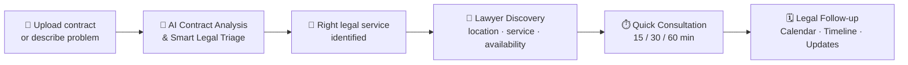
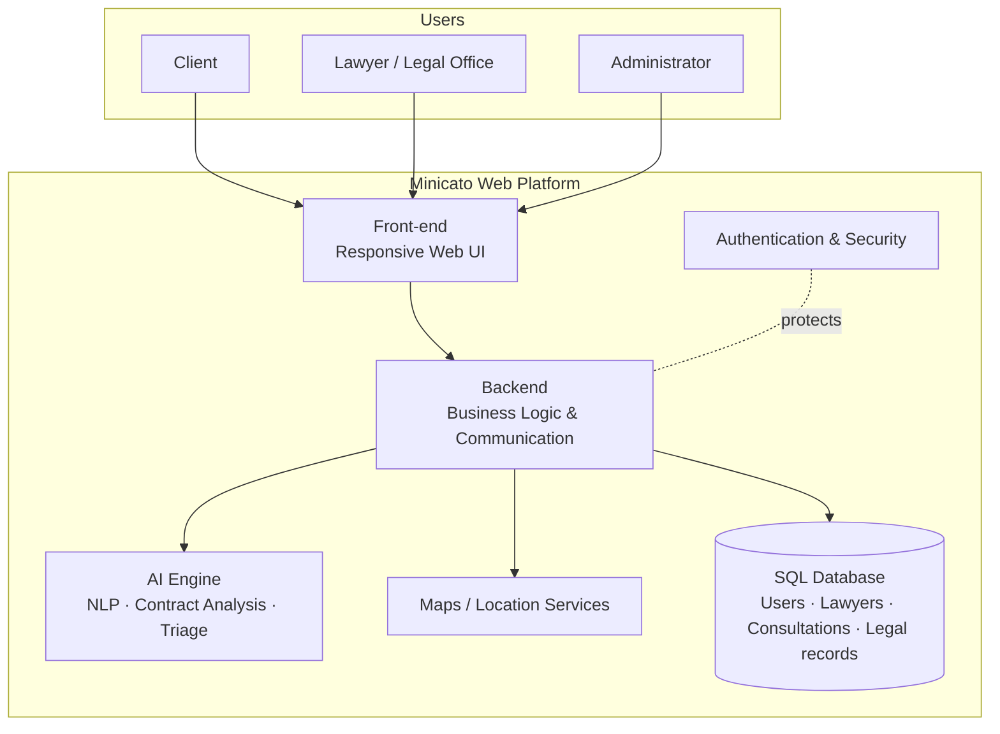

<div align="center">

# ⚖️ Minicato

### From legal problem to legal support — in one guided journey.

**AI-assisted legal guidance + professional lawyer services, in one connected web platform.**


[Overview](#-overview) · [Features](#-key-features) · [Journey](#-the-guided-legal-journey) · [Architecture](#-architecture) · [Roadmap](#-roadmap) · [Getting Started](#-getting-started)

</div>

---

## 📖 Overview

At some point, almost everyone needs legal support. In practice, getting it is hard:

- 📄 Legal documents are difficult to understand.
- 🔎 Finding the right lawyer takes time.
- ❓ Many people don't know **which type of legal service** they actually need.
- ⏰ Important legal updates are easily missed.
- 🗂️ Lawyers receive unstructured requests and carry extra workload organizing consultations, tasks and deadlines.

**Minicato** fixes this by changing the order of the process. Instead of making users search for a lawyer first, it helps them **understand their situation**, **identify the right legal direction**, and **then connect them with professional legal support**.

> **Vision:** Make the initial legal journey clearer, more structured, and easier to navigate, while connecting users with professional legal expertise when needed.

---

## ✨ Key Features

### 🤖 AI Assistance
| Feature | What it does |
|---|---|
| **AI Contract Analysis** | Upload a contract and get clause explanations, key rights & obligations, potential red flags, important terms, and pros & cons of provisions. |
| **Smart Legal Triage** | Describe your problem through guided intake and get directed to the relevant legal service or area *before* contacting a lawyer. |
| **Guided Support** | Step-by-step help for non-specialist users. |

### 🧑‍⚖️ Legal Services
| Feature | What it does |
|---|---|
| **Lawyer Discovery** | Find lawyers by **location**, **legal service**, and **availability**. |
| **Quick Consultation** | Book flexible **15, 30, or 60-minute** consultations. |
| **Legal Follow-up** | Stay connected to your matter after the first consultation. |

### 🗓️ Professional Workspace (for lawyers)
| Feature | What it does |
|---|---|
| **Calendar** | Manage consultations and appointments. |
| **Legal Timeline** | Track important dates, tasks, and case-related events. |
| **Relevant Legal Updates** | Surface updates that may affect upcoming or ongoing legal matters. |

---

## 🧭 The Guided Legal Journey



---

## 👥 Who Is It For?

| User group | What they get |
|---|---|
| **Clients** | Contract analysis, guided legal intake, lawyer discovery, bookable consultations, relevant legal updates. |
| **Lawyers** | Consultation & appointment management, organized client requests, task/timeline tracking via calendar, access to legal information and updates. |
| **Legal Offices / Junior Lawyers** | Structured client intake, consultation management, organized legal information. |
| **Administrators** | User management, lawyer verification, content management, system monitoring, platform administration. |
| **AI Assistant** | Clause explanation, rights & obligations, red-flag detection, important terms, pros & cons, and triage to the right legal area. |

---

## 🏗️ Architecture

Minicato unifies four actors in a single environment: **Clients, Lawyers, AI, and Administration.**



### Technology Stack

| Area | Technology | Why |
|---|---|---|
| Front-end | Web technologies | Responsive, consistent user interfaces |
| Backend | Backend framework | Business logic and system communication |
| Database | SQL database | Fits users, lawyers, consultations and legal records |
| AI Engine | AI / NLP models | Text understanding and intelligent assistance |
| Location | Maps / location services | Location-based lawyer search |
| Security | Authentication & security | Protects user and professional information |

> The final stack can be adjusted according to implementation requirements and available project resources.

---

## 🎯 Project Objectives

- Simplify access to legal assistance for non-specialist users.
- Help users understand contracts and legal information through AI-assisted analysis.
- Guide users to the appropriate legal service through Smart Legal Triage.
- Make it easy to find and communicate with suitable lawyers.
- Offer flexible consultation options by duration.
- Help lawyers organize consultations, legal tasks, and case timelines.
- Keep users informed about relevant legal updates.
- Create a unified digital environment connecting Clients, Lawyers, AI, and Administration.

---

## 📦 Expected Deliverables

1. **AI contract analysis** — clauses, rights & obligations, red flags, key terms, pros & cons.
2. **Smart Legal Triage & guided intake** — directs users to the right legal service or area.
3. **Lawyer discovery** — by location, legal service and availability, with 15/30/60-minute consultations.
4. **Lawyer workspace** — calendar and legal timeline for consultations, dates, tasks and case events.
5. **Legal updates** — identifies updates affecting upcoming or ongoing matters.

---

## 🧬 Project Lineage

Minicato builds on the same general legal-technology direction as the previous department project **Al Mostashar**, while introducing a **different functional structure** centered on guided, AI-assisted legal support.

---

## 🛣️ Roadmap

- [ ] Expand AI knowledge sources with additional legally available datasets and curated legal documents *(subject to licensing, privacy and data-access limitations)*
- [ ] Refine the AI / NLP models used for contract analysis and legal triage
- [ ] Review the technology stack against implementation requirements and available resources

---

## 🚀 Getting Started

> 🔧 *Fill in once the implementation stack is final.*

```bash
# 1. Clone the repository
git clone https://github.com/<your-username>/minicato.git
cd minicato

# 2. Install dependencies
# <command for your stack>

# 3. Configure environment variables
cp .env.example .env

# 4. Run the app
# <command for your stack>
```

---

## 📸 Screenshots

<!-- Add screenshots to /docs/screenshots and uncomment -->
<!--
| Contract Analysis | Smart Legal Triage | Lawyer Discovery |
|---|---|---|
|  |  |  |
-->

---

## 👨‍💻 Team

| Name | Role |
|---|---|
| _Your Name_ | _Role_ |
| _Team Member_ | _Role_ |

**Supervisor:** _Name_ · **Department / University:** _Name_

---

## ⚠️ Disclaimer

Minicato provides **AI-assisted guidance for understanding legal information**. It does not replace professional legal advice. For legal decisions, consult a qualified, verified lawyer.

---

## 📄 License

_Choose a license (e.g. MIT) and add a `LICENSE` file._

<div align="center">

**Minicato — Graduation Project Documentation**

*From legal problem to legal support.*

</div>
